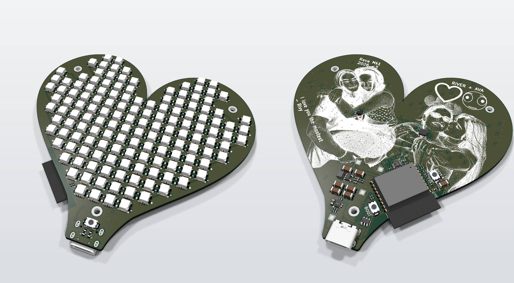
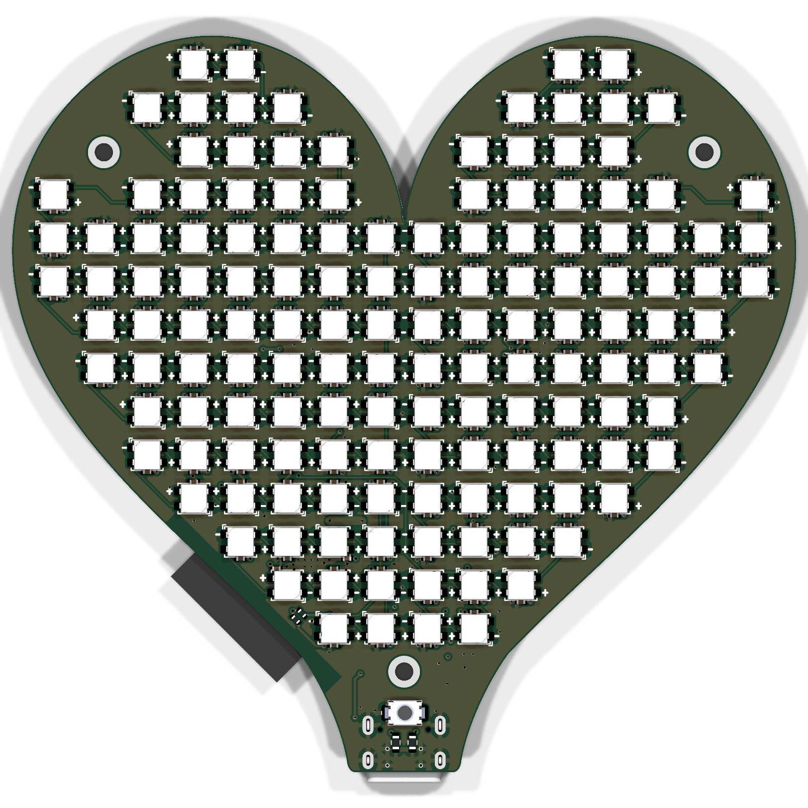
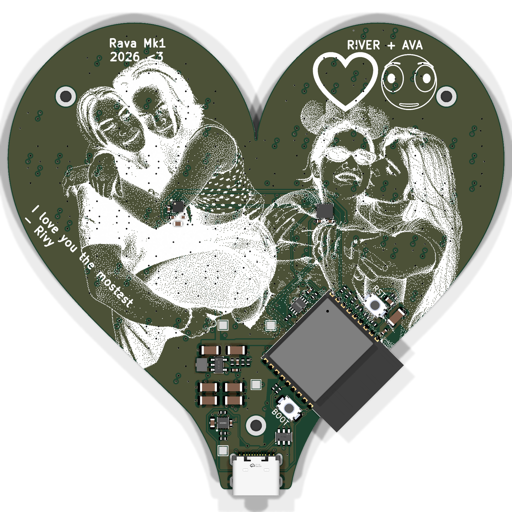

# Rava Heart

Two hearts that beat together. Literally, over ESP-NOW.

A heart-shaped PCB with 144 LEDs on the front, an ESP32-C3 on the back, and a matching one somewhere
nearby. When they can hear each other they share one heartbeat.

<!-- River: the name, and who the other heart is for, is yours to tell. -->

## Video

**Coming soon:** a video of the pair fully working.

<!-- River: drop the video here, e.g. a thumbnail linking to it. -->

## What it does

- **144 pixels.** WS2812B-MINI-V6 in two chains of 72, driven at a fixed 60 Hz.
- **Heartbeat.** A relaxed double pulse. Shake it and you get an extra beat.
- **Gravity Red.** A fixed amount of red "liquid" sloshes around the heart as you tilt it, with real
  momentum, flowing through the actual neighbour graph of the LEDs on the board.
- **Flowing Rainbow.** It is what it sounds like.
- **Find Heart.** A compass arrow. For now it points at magnetic north as a bench target.
- **I ♥ U.** Hold the mode button for 0.75 s and it plays on this heart and on the other one.
- **One heartbeat.** Hearts near each other lock to the same beat. The one with the lower MAC address
  leads. "Near" is −72 dBm (and gone again at −80 dBm).

The pairing link is group-filtered broadcast, not encrypted. That is on the list.

## Hardware

- 94.0 × 88.3 mm, four layers.
- ESP32-C3-WROOM-02, LSM6DSOX IMU, LIS3MDL magnetometer.
- USB-C in, a TPS259531 eFuse near 3 A, and a firmware LED budget of 2.5 A.
- [KiCad project](hardware/) · [fabrication exports](hardware/production/)

## Firmware

ESP-IDF 5.4 or newer, or PlatformIO. [Build notes, pin map and controls](firmware/README.md).

There is a simulator that runs the same effects in a browser with no build step:
[`firmware/simulator/index.html`](firmware/simulator/).

## The rest

- [`mechanical/`](mechanical/): the scripts that generated the outline, placed the LEDs and routed
  their power.
- [`silkscreen_art/`](silkscreen_art/): how the art on the back was made.

[MIT license](LICENSE).
