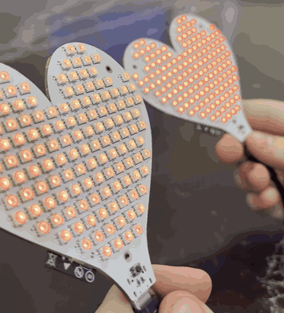

# Rava Heart

A heart-shaped PCB with 144 LEDs that syncs its heartbeat with a second one over ESP-NOW.
Put the two near each other and they beat together.

## Video

  

## What it does

- 144 WS2812B-MINI LEDs in two chains of 72, refreshed at 60 Hz
- Heartbeat mode: a slow double pulse, and shaking it adds an extra beat
- Gravity mode: red "liquid" sloshes around the heart as you tilt it
- Rainbow mode, because obviously
- Find Heart: a compass arrow (points north for now, eventually at the other heart)
- Hold the button for about a second and both hearts play "I ♥ U"
- When the two hearts are close enough they lock to the same beat

## Hardware

4-layer board, 94 × 88 mm, with an ESP32-C3, an accelerometer/gyro (LSM6DSOX) and a
magnetometer (LIS3MDL). Powered over USB-C, with an eFuse so 144 LEDs can't cook anything.

KiCad files are in [`hardware/`](hardware/), fab files in [`hardware/production/`](hardware/production/).

## Firmware

Builds with ESP-IDF 5.4+ or PlatformIO. Pin map, controls and build steps are in
[`firmware/README.md`](firmware/README.md).

There's also a browser simulator that runs the same effects with no hardware:
[`firmware/simulator/index.html`](firmware/simulator/).

## Other folders

- [`mechanical/`](mechanical/): scripts that generated the outline, placed the LEDs and routed power
- [`silkscreen_art/`](silkscreen_art/): how the back art was made

MIT licensed.
